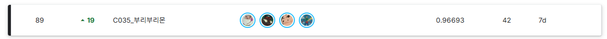

# SSAFY AI 챌린지 · 부리부리몬

**4명이 함께 참여한 이미지 객관식 질의응답(VQA) 프로젝트**입니다.
이미지와 질문, 네 개의 선지에서 정답을 선택하는 과제를 대상으로, 여러 비전 언어 모델을 비교하고 프롬프트와 추론 방식을 개선했습니다.

## 팀 협업

팀 **C035_부리부리몬**은 4명의 팀원이 함께 모델 성능 개선을 실험했습니다.
모델 선정과 비교, 프롬프트 개선, 오답 분석, 추론 방식 확장을 공동 과제로 삼았습니다.

- **모델 비교:** 기본 제공 모델 외에 EXAONE, Qwen 3.8, Gemma 4를 실험했습니다.
- **오답 분석과 프롬프트 개선:** 질문의 대상·조건, 이미지의 문자·숫자, 표의 행·열을 정확히 확인하도록 지시를 보완했습니다.
- **추론 방식 확장:** 선지 순서를 바꾸는 TTA, 선택적 Thinking, DINO 기반 확대 크롭을 구현하고 실험했습니다.
- **실행 환경 개선:** Colab의 자원과 실행 시간을 고려해 체크포인트 재개와 DINO의 GPU 실행을 지원하도록 코드를 개선했습니다.

이 저장소는 팀의 실험 코드와 시행착오를 정리한 기록입니다.
추론 확장 실험의 전체 실행 여부와 최종 제출에 반영한 구성은 추후 구분해 정리할 예정입니다.

## 리더보드 기록

| 팀 | 팀원 수 | 순위 | 점수 |
| --- | ---: | ---: | ---: |
| C035_부리부리몬 | 4명 | 89위 | 0.96693 |

아래 리더보드 화면에 표시된 기록입니다.

## 프로젝트 구성

| 폴더 | 내용 |
| --- | --- |
| `notebooks/` | 모델별 Colab 추론 노트북 |
| `scripts/` | 실행 보조 및 속도 개선 코드 |
| `requirements/` | 공통 패키지 목록 |
| `docs/` | 실행 안내와 실험 기록 |

노트북을 Colab에서 열고 데이터 경로를 설정한 뒤 순서대로 실행합니다.
자세한 설정은 [실행 안내](docs/run_guide.md)를 참고하세요. 데이터와 모델 가중치는 포함하지 않습니다.

> 팀원 소개와 역할, 모델별 비교 결과, 최종 제출 구성은 추후 추가할 예정입니다.
